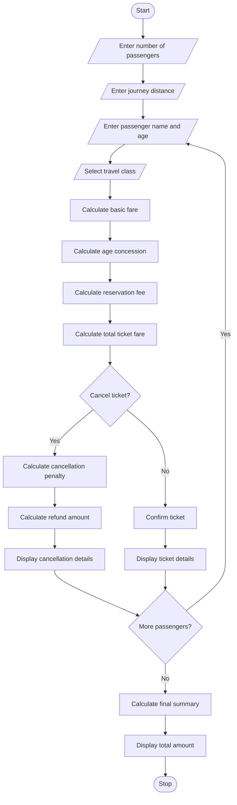
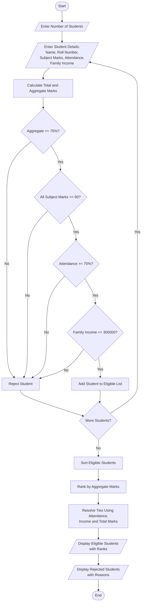

# Railway Fare and Reservation Calculator Using Python

## 1. Problem Statement
. Railway Fare and Reservation Calculator: Calculate fares for multiple passengers using distance slabs, travel classes, age-based concessions, reservation fees, and specified cancellation penalties. 


## 2. Algorithm

1. Start the program.
2. Read the number of passengers.
3. Read the journey distance in kilometres.
4. For each passenger:
   - Read passenger name and age.
   - Read the travel class.
   - Calculate the basic fare based on distance.
   - Apply the age-based concession:
     - Children below 5 years: Free basic fare.
     - Children aged 5–11 years: 50% concession.
     - Senior citizens aged 60 and above: 40% concession.
     - Other passengers: No concession.
   - Calculate the reservation fee according to travel class.
   - Calculate the total ticket fare.
   - Ask whether the ticket is cancelled.
   - If cancelled, calculate the cancellation penalty.
   - Otherwise, consider the ticket confirmed.
5. Display the fare details of each passenger.
6. Calculate the total amount for all passengers.
7. Display the final bill.
8. Stop.

## 3. Flowchart

Cấu trúc rẽ nhánh, thuật toán, Tin học 6.

[olm.vn](<https://olm.vn/chu-de/luyen-tap-bai-15-tin-hoc-lop-6-sach-chan-troi-sang-tao-chu-de-6-3479775781?utm_source=chatgpt.com>)

Flowchart explanation:

- Start with passenger and journey details.
- Calculate distance-based fare.
- Apply class charges and age concessions.
- Add reservation fees.
- Check cancellation status.
- Calculate cancellation penalty if applicable.
- Display the final fare details.

## 4. Python Source Code

The following program uses illustrative fare rates and concession rules for an academic project. These are not official Indian Railways rates.

python

```python

# Railway Fare and Reservation Calculator

def calculate_base_fare(distance, travel_class):

    # Fare rates per kilometre
    rates = {
        "Sleeper": 1.0,
        "AC3": 2.0,
        "AC2": 3.0,
        "AC1": 4.0
    }

    return distance * rates[travel_class]


def calculate_concession(age, fare):

    if age < 5:
        return fare       # Free basic fare

    elif age <= 11:
        return fare * 0.50

    elif age >= 60:
        return fare * 0.40

    else:
        return 0


def calculate_reservation_fee(travel_class):

    fees = {
        "Sleeper": 20,
        "AC3": 40,
        "AC2": 50,
        "AC1": 60
    }

    return fees[travel_class]


def calculate_cancellation_penalty(fare):

    # Illustrative cancellation penalty: 25%
    return fare * 0.25


# Main program

print("RAILWAY FARE AND RESERVATION CALCULATOR")

n = int(input("Enter number of passengers: "))
distance = float(input("Enter journey distance (km): "))

total_booking = 0
total_penalty = 0

for i in range(n):

    print("\nPassenger", i + 1)

    name = input("Enter passenger name: ")
    age = int(input("Enter passenger age: "))

    print("Classes: Sleeper, AC3, AC2, AC1")
    travel_class = input("Enter travel class: ").strip()

    travel_class = travel_class.upper()

    # Normalize class names
    if travel_class == "SLEEPER":
        travel_class = "Sleeper"
    elif travel_class == "AC3":
        travel_class = "AC3"
    elif travel_class == "AC2":
        travel_class = "AC2"
    elif travel_class == "AC1":
        travel_class = "AC1"
    else:
        print("Invalid travel class!")
        continue

    # Calculate basic fare
    base_fare = calculate_base_fare(
        distance, travel_class
    )

    # Calculate age concession
    concession = calculate_concession(
        age, base_fare
    )

    # Calculate reservation fee
    reservation_fee = calculate_reservation_fee(
        travel_class
    )

    # Final ticket fare
    ticket_fare = (
        base_fare - concession + reservation_fee
    )

    print("\nCancellation Status")
    cancel = input("Cancel ticket? (yes/no): ").lower()

    if cancel == "yes":

        penalty = calculate_cancellation_penalty(
            ticket_fare
        )

        refund = ticket_fare - penalty

        total_penalty += penalty

        print("\n--- Cancellation Details ---")
        print("Passenger:", name)
        print("Ticket Fare: Rs.", round(ticket_fare, 2))
        print("Cancellation Penalty: Rs.",
              round(penalty, 2))
        print("Refund Amount: Rs.", round(refund, 2))

    else:

        penalty = 0
        total_booking += ticket_fare

        print("\n--- Ticket Details ---")
        print("Passenger:", name)
        print("Age:", age)
        print("Travel Class:", travel_class)
        print("Distance:", distance, "km")
        print("Basic Fare: Rs.", round(base_fare, 2))
        print("Age Concession: Rs.",
              round(concession, 2))
        print("Reservation Fee: Rs.",
              round(reservation_fee, 2))
        print("Total Fare: Rs.",
              round(ticket_fare, 2))

print("\n========== FINAL SUMMARY ==========")
print("Total Confirmed Booking: Rs.",
      round(total_booking, 2))
print("Total Cancellation Penalty: Rs.",
      round(total_penalty, 2))
print("Total Amount Collected: Rs.",
      round(total_booking + total_penalty, 2))

print("Thank You! Happy Journey!")
```

## 5. Sample Input

text

```text
RAILWAY FARE AND RESERVATION CALCULATOR

Enter number of passengers: 3
Enter journey distance (km): 500

Passenger 1
Enter passenger name: Ravi
Enter passenger age: 30
Enter travel class: Sleeper
Cancel ticket? (yes/no): no

Passenger 2
Enter passenger name: Sita
Enter passenger age: 65
Enter travel class: AC3
Cancel ticket? (yes/no): no

Passenger 3
Enter passenger name: Arun
Enter passenger age: 10
Enter travel class: AC2
Cancel ticket? (yes/no): yes
```

## 6. Sample Output

Using the fare rates defined in the program:

Passenger 1 – Ravi

| Description | Amount |
| --- | --- |
| Basic fare | ₹500 |
| Concession | ₹0 |
| Reservation fee | ₹20 |
| Total fare | ₹520 |

Passenger 2 – Sita

| Description | Amount |
| --- | --- |
| Basic fare | ₹1,000 |
| Senior concession (40%) | −₹400 |
| Reservation fee | ₹40 |
| Total fare | ₹640 |

Passenger 3 – Arun

| Description | Amount |
| --- | --- |
| Basic fare | ₹1,500 |
| Child concession (50%) | −₹750 |
| Reservation fee | ₹50 |
| Ticket fare | ₹800 |
| Cancellation penalty (25%) | ₹200 |
| Refund amount | ₹600 |

Final Summary

| Description | Amount |
| --- | --- |
| Confirmed bookings | ₹1,160 |
| Cancellation penalty | ₹200 |
| Total amount collected | ₹1,360 |

Calculation completed

Equivalent console output:

text

```text
========== FINAL SUMMARY ==========

Total Confirmed Booking: Rs. 1160.0
Total Cancellation Penalty: Rs. 200.0
Total Amount Collected: Rs. 1360.0

Thank You! Happy Journey!
```

## 7. Mermaid Flowchart Code

You can copy this code into the [Mermaid Live Editor](<https://mermaid.live/?utm_source=chatgpt.com>) to generate the flowchart.

mermaid



## 8. Expected Result

The Railway Fare and Reservation Calculator successfully calculates railway ticket fares for multiple passengers based on distance, travel class, age concessions, reservation charges, and cancellation penalties.

Conclusion: This Python program demonstrates the use of functions, conditional statements, loops, arithmetic operations, and user input to develop a railway reservation and fare calculation system.

- Accept student details as input.
- Check whether each student satisfies all eligibility conditions.
- Rank eligible students based on aggregate marks.
- Resolve ties using predefined rules:
  1. Higher aggregate marks.
  2. Higher attendance percentage.
  3. Lower annual family income.
  4. Higher total subject marks.
- Display the eligible students in ranked order.
- Display rejected students with their reasons for rejection.

## 2. Algorithm

Step 1: Start the program.

Step 2: Read the number of students.

Step 3: For each student, input:

- Student name
- Roll number
- Marks in each subject
- Attendance percentage
- Annual family income

Step 4: Calculate aggregate percentage.

$$
Aggregate = \frac{Total\ Marks}{Maximum\ Marks}\times100
$$

Step 5: Check eligibility conditions:

- Aggregate percentage ≥ 75%.
- Each subject mark ≥ 60.
- Attendance ≥ 75%.
- Annual family income ≤ ₹3,00,000.

Step 6: If all conditions are satisfied, add the student to the eligible list.

Step 7: Otherwise, display the reason for rejection.

Step 8: Sort eligible students using the following priority:

1. Aggregate percentage in descending order.
2. Attendance percentage in descending order.
3. Annual family income in ascending order.
4. Total subject marks in descending order.

Step 9: Assign ranks to eligible students.

Step 10: Display the scholarship allocation results.

Step 11: Stop the program.

## 3. Flowchart

3.2 Algorithms - IB Questionbank | RevisionDojo

[revisiondojo.com](<https://www.revisiondojo.com/ib/ib-digital-society/3-2-algorithms/questionbank?utm_source=chatgpt.com>)

Flowchart explanation:

- Start the program.
- Enter student details.
- Calculate aggregate marks.
- Check academic, attendance, and income eligibility.
- If eligible, add the student to the eligible list.
- Otherwise, record the rejection reason.
- Sort eligible students based on tie-breaking rules.
- Display student ranks and results.
- End the program.

## 4. Python Source Code

python

```python

# University Scholarship Allocation System

students = []
eligible_students = []
rejected_students = []

# Scholarship eligibility criteria
MIN_AGGREGATE = 75
MIN_SUBJECT_MARK = 60
MIN_ATTENDANCE = 75
MAX_INCOME = 300000

# Number of students
n = int(input("Enter number of students: "))

# Input student details
for i in range(n):
    print("\nEnter details of Student", i + 1)

    roll_no = input("Enter Roll Number: ")
    name = input("Enter Student Name: ")

    marks = []
    for j in range(3):
        mark = int(input(f"Enter marks in Subject {j + 1}: "))
        marks.append(mark)

    attendance = float(input("Enter Attendance Percentage: "))
    income = float(input("Enter Annual Family Income: "))

    total = sum(marks)
    aggregate = (total / 300) * 100

    student = {
        "roll_no": roll_no,
        "name": name,
        "marks": marks,
        "total": total,
        "aggregate": aggregate,
        "attendance": attendance,
        "income": income
    }

    # Eligibility checking
    reasons = []

    if aggregate < MIN_AGGREGATE:
        reasons.append("Aggregate below 75%")

    if min(marks) < MIN_SUBJECT_MARK:
        reasons.append("Subject mark below 60")

    if attendance < MIN_ATTENDANCE:
        reasons.append("Attendance below 75%")

    if income > MAX_INCOME:
        reasons.append("Family income exceeds Rs. 300000")

    if len(reasons) == 0:
        eligible_students.append(student)
    else:
        student["reason"] = reasons
        rejected_students.append(student)


# Ranking eligible students
# Priority:
# 1. Higher aggregate
# 2. Higher attendance
# 3. Lower family income
# 4. Higher total marks

eligible_students.sort(
    key=lambda s: (
        -s["aggregate"],
        -s["attendance"],
        s["income"],
        -s["total"]
    )
)

# Display eligible students
print("\n========== SCHOLARSHIP ELIGIBLE STUDENTS ==========")

if eligible_students:
    print("Rank  Roll No  Name  Aggregate  Attendance  Income")

    for rank, s in enumerate(eligible_students, start=1):
        print(
            rank,
            s["roll_no"],
            s["name"],
            f"{s['aggregate']:.2f}%",
            f"{s['attendance']}%",
            s["income"]
        )
else:
    print("No eligible students found.")

# Display rejected students
print("\n========== REJECTED STUDENTS ==========")

if rejected_students:
    for s in rejected_students:
        print("\nName:", s["name"])
        print("Roll Number:", s["roll_no"])
        print("Reason(s):", ", ".join(s["reason"]))
else:
    print("No rejected students.")

print("\nScholarship allocation process completed.")
```

## 5. Sample Input

Consider the following sample data with three subjects, each carrying 100 marks.

text

```text
Enter number of students: 5

Enter details of Student 1
Enter Roll Number: 101
Enter Student Name: Arun
Enter marks in Subject 1: 90
Enter marks in Subject 2: 85
Enter marks in Subject 3: 95
Enter Attendance Percentage: 90
Enter Annual Family Income: 200000

Enter details of Student 2
Enter Roll Number: 102
Enter Student Name: Banu
Enter marks in Subject 1: 80
Enter marks in Subject 2: 85
Enter marks in Subject 3: 90
Enter Attendance Percentage: 95
Enter Annual Family Income: 250000

Enter details of Student 3
Enter Roll Number: 103
Enter Student Name: Charan
Enter marks in Subject 1: 55
Enter marks in Subject 2: 85
Enter marks in Subject 3: 90
Enter Attendance Percentage: 90
Enter Annual Family Income: 200000

Enter details of Student 4
Enter Roll Number: 104
Enter Student Name: Divya
Enter marks in Subject 1: 75
Enter marks in Subject 2: 80
Enter marks in Subject 3: 85
Enter Attendance Percentage: 70
Enter Annual Family Income: 180000

Enter details of Student 5
Enter Roll Number: 105
Enter Student Name: Ezhil
Enter marks in Subject 1: 85
Enter marks in Subject 2: 90
Enter marks in Subject 3: 95
Enter Attendance Percentage: 92
Enter Annual Family Income: 400000
```

## 6. Sample Output

text

```text
========== SCHOLARSHIP ELIGIBLE STUDENTS ==========

Rank  Roll No  Name   Aggregate  Attendance  Income

1     101      Arun   90.00%     90%         200000
2     102      Banu   85.00%     95%         250000

========== REJECTED STUDENTS ==========

Name: Charan
Roll Number: 103
Reason(s): Subject mark below 60

Name: Divya
Roll Number: 104
Reason(s): Attendance below 75%

Name: Ezhil
Roll Number: 105
Reason(s): Family income exceeds Rs. 300000

Scholarship allocation process completed.
```

## 7. Mermaid Flowchart Code

The following Mermaid code represents the complete scholarship allocation process.

mermaid



## 8. Expected Result

The University Scholarship Allocation System successfully evaluates students based on academic marks, subject-wise minimum scores, attendance percentage, and family income.

- Eligible students are selected automatically.
- Ineligible students are rejected with appropriate reasons.
- Eligible students are ranked according to academic performance.
- Ties are resolved using attendance, family income, and total marks.

Conclusion: Thus, the University Scholarship Allocation System is implemented successfully using Python. It provides a simple, transparent, and efficient method for selecting and ranking scholarship applicants.
