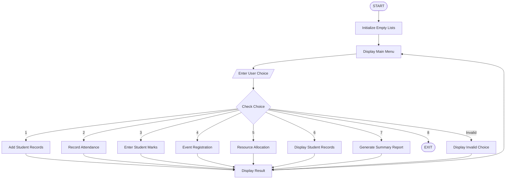

# Comprehensive Smart Campus Management Simulation Using Python

## 1. Problem Statement

Comprehensive Smart Campus Management Simulation: Develop a menu-driven program that integrates student records, attendance, marks, event registration, resource allocation, and summary reporting using conditional statements, loops, strings, lists, nested lists, tuples, and tuple unpacking


## 2. Algorithm

1. Start the program.
2. Initialize empty lists for student records, attendance, marks, event registrations, and resource allocations.
3. Display the main menu.
4. Accept the user's choice.
5. Perform the selected operation:
   - Choice 1: Add student details.
   - Choice 2: Record attendance.
   - Choice 3: Enter marks and calculate grades.
   - Choice 4: Register students for events.
   - Choice 5: Allocate campus resources.
   - Choice 6: Display the campus summary report.
   - Choice 7: Exit the program.
6. Use conditional statements to execute the selected operation.
7. Use loops to process multiple student records.
8. Use nested lists to store multiple subject marks and attendance details.
9. Use tuples and tuple unpacking to store and retrieve resource information.
10. Repeat the menu until the user selects Exit.
11. Stop the program.

## 3. Flowchart

PPT - Starting Out with Programming Logic &amp; Design Second Edition by Tony Gaddis PowerPoint Presentation - ID:4388869

[slideserve.com](<https://www.slideserve.com/kaya/starting-out-with-programming-logic-design-second-edition-by-tony-gaddis?utm_source=chatgpt.com>)

Flowchart explanation:

- Start and initialize the campus management system.
- Display the menu and accept the user's choice.
- Check the selected option.
- Execute the corresponding operation.
- Display the result.
- Return to the menu.
- If the user selects Exit, terminate the program.

## 4. Python Source Code

python

```python

# SMART CAMPUS MANAGEMENT SYSTEM

students = []
attendance = []
marks = []
events = []
resources = []

# Function to add student details
def add_student():
    roll = input("Enter Roll Number: ")
    name = input("Enter Student Name: ")
    dept = input("Enter Department: ")
    year = input("Enter Year: ")

    student = [roll, name, dept, year]
    students.append(student)

    print("Student record added successfully!")


# Function to record attendance
def record_attendance():
    roll = input("Enter Roll Number: ")
    total = int(input("Enter Total Working Days: "))
    present = int(input("Enter Present Days: "))

    if total <= 0 or present < 0 or present > total:
        print("Invalid attendance details!")
        return

    percentage = (present / total) * 100

    attendance.append([roll, total, present, percentage])

    print("Attendance recorded successfully!")
    print("Attendance Percentage:", round(percentage, 2), "%")


# Function to enter marks
def enter_marks():
    roll = input("Enter Roll Number: ")

    subject_marks = []

    n = int(input("Enter Number of Subjects: "))

    if n <= 0:
        print("Invalid number of subjects!")
        return

    for i in range(n):
        mark = float(input("Enter mark for subject " + str(i + 1) + ": "))

        if mark < 0 or mark > 100:
            print("Invalid mark! Enter between 0 and 100.")
            return

        subject_marks.append(mark)

    total = sum(subject_marks)
    average = total / n

    if average >= 90:
        grade = "A+"
    elif average >= 80:
        grade = "A"
    elif average >= 70:
        grade = "B"
    elif average >= 60:
        grade = "C"
    elif average >= 50:
        grade = "D"
    else:
        grade = "F"

    marks.append([roll, subject_marks, total, average, grade])

    print("Marks recorded successfully!")
    print("Total Marks:", total)
    print("Average:", round(average, 2))
    print("Grade:", grade)


# Function for event registration
def event_registration():
    roll = input("Enter Roll Number: ")
    event_name = input("Enter Event Name: ")

    events.append([roll, event_name])

    print("Event registration successful!")


# Function for resource allocation
def allocate_resource():
    roll = input("Enter Roll Number: ")
    resource = input("Enter Resource Name: ")
    time = input("Enter Allocation Time: ")

    # Tuple creation
    allocation = (roll, resource, time)

    resources.append(allocation)

    print("Resource allocated successfully!")


# Function to display student records
def display_students():
    print("\n--- STUDENT RECORDS ---")

    if not students:
        print("No student records available.")
        return

    for student in students:
        roll, name, dept, year = student
        print("Roll No:", roll,
              "| Name:", name,
              "| Department:", dept,
              "| Year:", year)


# Function to generate summary report
def summary_report():
    print("\n========== CAMPUS SUMMARY REPORT ==========")

    print("\nSTUDENT DETAILS:")
    for student in students:
        print(student)

    print("\nATTENDANCE DETAILS:")
    for record in attendance:
        roll, total, present, percentage = record
        print("Roll:", roll,
              "Present:", present,
              "/", total,
              "Percentage:", round(percentage, 2), "%")

    print("\nMARKS DETAILS:")
    for record in marks:
        roll, subject_marks, total, average, grade = record
        print("Roll:", roll,
              "Marks:", subject_marks,
              "Total:", total,
              "Average:", round(average, 2),
              "Grade:", grade)

    print("\nEVENT REGISTRATIONS:")
    for event in events:
        print("Roll:", event[0],
              "Event:", event[1])

    print("\nRESOURCE ALLOCATIONS:")
    for resource in resources:
        roll, name, time = resource
        print("Roll:", roll,
              "Resource:", name,
              "Time:", time)

    print("\n===========================================")


# Main menu-driven program
while True:

    print("\n====== SMART CAMPUS MANAGEMENT SYSTEM ======")
    print("1. Add Student Records")
    print("2. Record Attendance")
    print("3. Enter Student Marks")
    print("4. Event Registration")
    print("5. Resource Allocation")
    print("6. Display Student Records")
    print("7. Campus Summary Report")
    print("8. Exit")

    choice = input("Enter Your Choice: ")

    if choice == "1":
        add_student()

    elif choice == "2":
        record_attendance()

    elif choice == "3":
        enter_marks()

    elif choice == "4":
        event_registration()

    elif choice == "5":
        allocate_resource()

    elif choice == "6":
        display_students()

    elif choice == "7":
        summary_report()

    elif choice == "8":
        print("Thank you for using Smart Campus Management System!")
        break

    else:
        print("Invalid Choice! Please try again.")
```

## 5. Sample Input

The following is an example execution of the program.

text

```text
====== SMART CAMPUS MANAGEMENT SYSTEM ======
1. Add Student Records
2. Record Attendance
3. Enter Student Marks
4. Event Registration
5. Resource Allocation
6. Display Student Records
7. Campus Summary Report
8. Exit

Enter Your Choice: 1

Enter Roll Number: 101
Enter Student Name: Rahul
Enter Department: CSE
Enter Year: 2

Student record added successfully!
```

Attendance input:

text

```text
Enter Your Choice: 2

Enter Roll Number: 101
Enter Total Working Days: 100
Enter Present Days: 90

Attendance recorded successfully!
Attendance Percentage: 90.0 %
```

Marks input:

text

```text
Enter Your Choice: 3

Enter Roll Number: 101
Enter Number of Subjects: 3

Enter mark for subject 1: 90
Enter mark for subject 2: 85
Enter mark for subject 3: 95

Marks recorded successfully!
Total Marks: 270.0
Average: 90.0
Grade: A+
```

Event registration input:

text

```text
Enter Your Choice: 4

Enter Roll Number: 101
Enter Event Name: Technical Fest

Event registration successful!
```

Resource allocation input:

text

```text
Enter Your Choice: 5

Enter Roll Number: 101
Enter Resource Name: Computer Lab
Enter Allocation Time: 10 AM

Resource allocated successfully!
```

## 6. Sample Output

When the user selects option 7, the following summary report is displayed.

text

```text
========== CAMPUS SUMMARY REPORT ==========

STUDENT DETAILS:
['101', 'Rahul', 'CSE', '2']

ATTENDANCE DETAILS:
Roll: 101 Present: 90 / 100 Percentage: 90.0 %

MARKS DETAILS:
Roll: 101
Marks: [90.0, 85.0, 95.0]
Total: 270.0
Average: 90.0
Grade: A+

EVENT REGISTRATIONS:
Roll: 101 Event: Technical Fest

RESOURCE ALLOCATIONS:
Roll: 101 Resource: Computer Lab
Time: 10 AM

===========================================

====== SMART CAMPUS MANAGEMENT SYSTEM ======
1. Add Student Records
2. Record Attendance
3. Enter Student Marks
4. Event Registration
5. Resource Allocation
6. Display Student Records
7. Campus Summary Report
8. Exit

Enter Your Choice: 8

Thank you for using Smart Campus Management System!
```

## 7. Mermaid Flowchart Code

You can copy this code into the [Mermaid Live Editor](<https://mermaid.live/?utm_source=chatgpt.com>) to generate the flowchart.

mermaid



## 8. Python Concepts Used

| Python concept | Application in program |
| --- | --- |
| Conditional statements | Menu selection and grade calculation |
| While loop | Repeated menu display |
| For loop | Processing student records and marks |
| Strings | Student names, departments, events |
| Lists | Storing student information |
| Nested lists | Attendance and subject marks |
| Tuples | Resource allocation |
| Tuple unpacking | Retrieving student and resource details |
| Functions | Dividing the program into modules |
| `sum()` | Calculating total marks |

## 9. Expected Result

The Smart Campus Management System was successfully developed using Python. It integrates student record management, attendance tracking, marks calculation, event registration, resource allocation, and summary reporting.

The program demonstrates the effective use of conditional statements, loops, strings, lists, nested lists, tuples, tuple unpacking, and functions in a menu-driven application.

Program completed Result: The program executes successfully and provides an organized simulation of smart campus activities.
