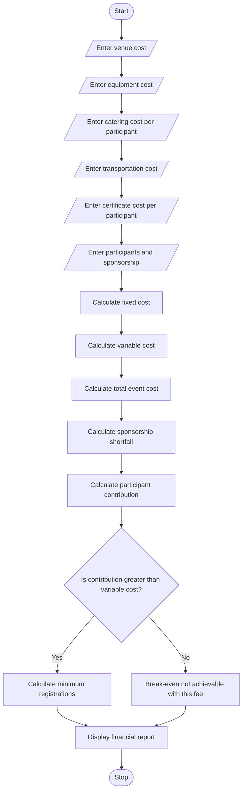

# Campus Event Financial Planning System Using Python

## 1. Problem Statement

 Campus Event Financial Planning: Calculate venue, equipment, catering, transport, and certificate costs; determine participant contributions, sponsorship shortfalls, and the minimum registration count needed to break even


## 2. Algorithm

1. Start the program.
2. Read the venue cost.
3. Read the equipment cost.
4. Read the catering cost per participant.
5. Read the transportation cost.
6. Read the certificate cost per participant.
7. Read the number of registered participants.
8. Read the sponsorship amount.
9. Calculate total fixed cost:
   - Venue + Equipment + Transportation.
10. Calculate variable cost per participant:

- Catering cost + Certificate cost.

11. Calculate total variable cost:

- Variable cost per participant × Number of participants.

12. Calculate total event cost:

- Fixed cost + Total variable cost.

13. Calculate sponsorship shortfall:

- Total event cost − Sponsorship amount.

14. Calculate participant contribution per person.
15. Calculate the minimum registration count required to break even.
16. Display all expenses and financial results.
17. Stop.

## 3. Flowchart

flowchart with xmind | Xmind - Xmind

[xmind.app](<https://xmind.app/mindmap/flowchart-with-xmind/NuBH8z/?from=gallery&utm_source=chatgpt.com>)

## 4. Python Source Code

python

```python

# Campus Event Financial Planning System

print("===== CAMPUS EVENT FINANCIAL PLANNING =====")

# Input details
venue = float(input("Enter venue cost: "))
equipment = float(input("Enter equipment cost: "))
catering = float(input("Enter catering cost per participant: "))
transport = float(input("Enter transportation cost: "))
certificate = float(input("Enter certificate cost per participant: "))

participants = int(input("Enter number of participants: "))
sponsorship = float(input("Enter sponsorship amount: "))

# Calculate fixed costs
fixed_cost = venue + equipment + transport

# Calculate variable costs
variable_cost = catering + certificate
total_variable_cost = variable_cost * participants

# Calculate total event cost
total_cost = fixed_cost + total_variable_cost

# Calculate sponsorship shortfall
shortfall = max(0, total_cost - sponsorship)

# Calculate participant contribution
remaining_amount = max(0, total_cost - sponsorship)

if participants > 0:
    contribution = remaining_amount / participants
else:
    contribution = 0

# Calculate minimum registrations to break even
# Assume each participant pays the calculated contribution
# and sponsorship is fixed.

if contribution > variable_cost:
    min_participants = fixed_cost / (contribution - variable_cost)
    min_participants = int(min_participants) + (
        int(min_participants) < min_participants
    )
else:
    min_participants = 0

# Display results
print("\n===== EVENT FINANCIAL REPORT =====")
print("Venue Cost:", venue)
print("Equipment Cost:", equipment)
print("Catering Cost:", catering * participants)
print("Transportation Cost:", transport)
print("Certificate Cost:", certificate * participants)

print("Fixed Cost:", fixed_cost)
print("Variable Cost:", total_variable_cost)
print("Total Event Cost:", total_cost)
print("Sponsorship Amount:", sponsorship)
print("Sponsorship Shortfall:", shortfall)

print("Participant Contribution Per Person:", round(contribution, 2))
print("Minimum Registrations Required:", min_participants)

if sponsorship >= total_cost:
    print("Event Status: Fully Sponsored")
elif shortfall > 0:
    print("Event Status: Additional Funding Required")
```

## 5. Sample Input

text

```text
===== CAMPUS EVENT FINANCIAL PLANNING =====
Enter venue cost: 10000
Enter equipment cost: 5000
Enter catering cost per participant: 200
Enter transportation cost: 3000
Enter certificate cost per participant: 50
Enter number of participants: 100
Enter sponsorship amount: 10000
```

## 6. Sample Output

text

```text
===== EVENT FINANCIAL REPORT =====

Venue Cost: 10000.0
Equipment Cost: 5000.0
Catering Cost: 20000.0
Transportation Cost: 3000.0
Certificate Cost: 5000.0

Fixed Cost: 18000.0
Variable Cost: 25000.0
Total Event Cost: 43000.0
Sponsorship Amount: 10000.0
Sponsorship Shortfall: 33000.0

Participant Contribution Per Person: 330.0
Minimum Registrations Required: 100

Event Status: Additional Funding Required
```

## 7. Mermaid Flowchart Code

You can copy this code into the [Mermaid Live Editor](<https://mermaid.live/?utm_source=chatgpt.com>) to generate the flowchart.

mermaid



## 8. Formulae Used

| Calculation | Formula |
| --- | --- |
| Fixed cost | Venue + Equipment + Transport |
| Variable cost per participant | Catering + Certificate |
| Total variable cost | Variable cost × Participants |
| Total event cost | Fixed cost + Total variable cost |
| Sponsorship shortfall | Max(0, Total Cost − Sponsorship) |
| Participant contribution | Shortfall ÷ Participants |

Break-even registration formula:

If each participant pays a fixed registration fee $R$, then:

$$
N = \left\lceil \frac{F-S}{R-V} \right\rceil
$$

Where:

- $N$ = Minimum number of participants
- $F$ = Fixed costs
- $S$ = Sponsorship amount
- $R$ = Registration fee per participant
- $V$ = Variable cost per participant

Note: The Python code above calculates the contribution based on the current registration count. For a true break-even calculation at a chosen registration fee, the fee must be entered separately. The formula requires $R>V$.

## 9. Conclusion

The Campus Event Financial Planning System helps college organizers estimate event expenses, calculate sponsorship shortfalls, determine participant contributions, and plan the minimum registrations needed to break even. It reduces manual calculations and supports effective event budget management.
