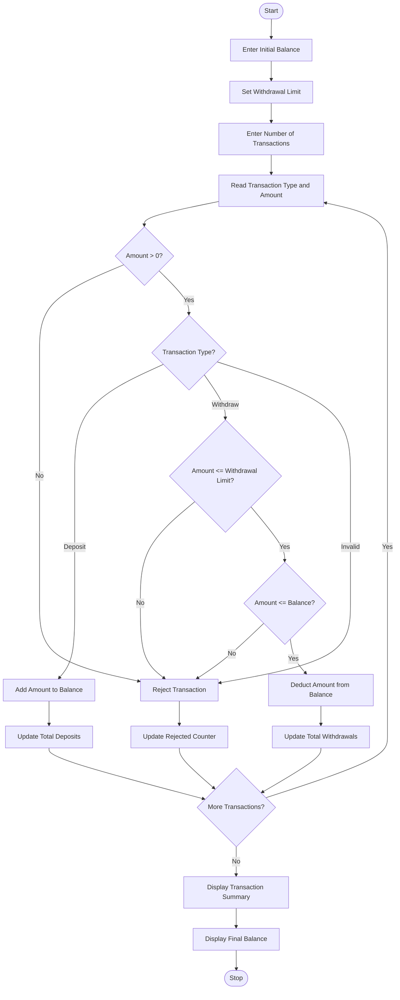

# ATM Transaction Sequence Simulation Using Python

## 1. Problem Statement
 ATM Transaction Sequence Simulation: Process a sequence of deposits and withdrawals, maintain a simulated balance, enforce withdrawal limits, reject invalid transactions, and produce a transaction summary. 


## 2. Algorithm

1. Start the program.
2. Initialize the account balance.
3. Set the maximum withdrawal limit.
4. Initialize counters for deposits, withdrawals, and rejected transactions.
5. Ask the user to enter the number of transactions.
6. Repeat the following steps for each transaction:
   - Read the transaction type (Deposit or Withdraw).
   - Read the transaction amount.
   - Check whether the amount is greater than zero.
   - If the transaction is a deposit:
     - Add the amount to the account balance.
     - Update the total deposits.
   - If the transaction is a withdrawal:
     - Check whether the amount exceeds the withdrawal limit.
     - Check whether sufficient balance is available.
     - If both conditions are satisfied, deduct the amount.
     - Otherwise, reject the transaction.
   - If the transaction type is invalid, reject it.
7. Display the final account balance.
8. Display the transaction summary.
9. Stop the program.

## 3. Flowchart

PPT - The Need for Program Design PowerPoint Presentation, free download - ID:9505408

[slideserve.com](<https://www.slideserve.com/derrickweaver/the-need-for-program-design-powerpoint-ppt-presentation?utm_source=chatgpt.com>)

### Flowchart Explanation

- Start the ATM system.
- Enter the initial balance and withdrawal limit.
- Enter the transaction type and amount.
- Check whether the amount is valid.
- If Deposit, add money to the balance.
- If Withdraw, check withdrawal limit and available balance.
- Accept or reject the transaction.
- Update the transaction counters.
- Display the final balance and summary.
- End the program.

## 4. Python Source Code

python

```python

# ATM Transaction Sequence Simulation

# Initial account details
balance = float(input("Enter initial account balance: "))
withdrawal_limit = 10000

# Transaction counters
total_deposits = 0
total_withdrawals = 0
rejected_transactions = 0

# Transaction count
n = int(input("Enter number of transactions: "))

for i in range(n):

    print("\nTransaction", i + 1)
    print("1. Deposit")
    print("2. Withdraw")

    choice = input("Enter transaction type (1/2): ")
    amount = float(input("Enter transaction amount: "))

    # Validate transaction amount
    if amount <= 0:
        print("Rejected: Invalid transaction amount.")
        rejected_transactions += 1

    # Deposit transaction
    elif choice == '1':
        balance += amount
        total_deposits += amount
        print("Deposit successful.")
        print("Current balance:", balance)

    # Withdrawal transaction
    elif choice == '2':

        if amount > withdrawal_limit:
            print("Rejected: Withdrawal limit exceeded.")
            rejected_transactions += 1

        elif amount > balance:
            print("Rejected: Insufficient balance.")
            rejected_transactions += 1

        else:
            balance -= amount
            total_withdrawals += amount
            print("Withdrawal successful.")
            print("Current balance:", balance)

    # Invalid transaction type
    else:
        print("Rejected: Invalid transaction type.")
        rejected_transactions += 1

# Transaction summary
print("\n========== ATM TRANSACTION SUMMARY ==========")
print("Total Deposits       :", total_deposits)
print("Total Withdrawals    :", total_withdrawals)
print("Rejected Transactions:", rejected_transactions)
print("Final Account Balance:", balance)
print("=============================================")
```

## 5. Sample Input

text

```text
Enter initial account balance: 15000
Enter number of transactions: 5

Transaction 1
Enter transaction type (1/2): 1
Enter transaction amount: 5000

Transaction 2
Enter transaction type (1/2): 2
Enter transaction amount: 3000

Transaction 3
Enter transaction type (1/2): 2
Enter transaction amount: 12000

Transaction 4
Enter transaction type (1/2): 2
Enter transaction amount: 20000

Transaction 5
Enter transaction type (1/2): 1
Enter transaction amount: 2000
```

## 6. Sample Output

text

```text
Deposit successful.
Current balance: 20000.0

Withdrawal successful.
Current balance: 17000.0

Rejected: Withdrawal limit exceeded.

Rejected: Withdrawal limit exceeded.

Deposit successful.
Current balance: 19000.0

========== ATM TRANSACTION SUMMARY ==========
Total Deposits       : 7000.0
Total Withdrawals    : 3000.0
Rejected Transactions: 2
Final Account Balance: 19000.0
=============================================
```

## 7. Mermaid Flowchart Code

You can copy this code into the [Mermaid Live Editor](<https://mermaid.live/?utm_source=chatgpt.com>) to visualize the flowchart.

mermaid



## 8. Expected Result

The Python program successfully simulates ATM transactions by processing deposits and withdrawals, maintaining the account balance, enforcing withdrawal limits, rejecting invalid transactions, and generating a transaction summary.

Result Thus, the ATM Transaction Sequence Simulation is successfully implemented using Python.
