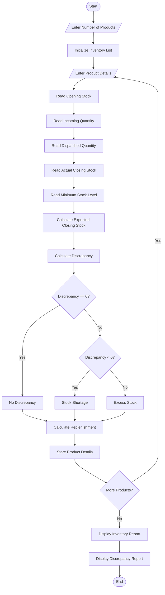

# Warehouse Inventory Reconciliation System Using Python

## 1. Problem Statement
 Warehouse Inventory Reconciliation: Compare opening stock, incoming quantities, dispatched quantities, and closing stock across multiple products; detect discrepancies and calculate replenishment requirements. 


## 2. Algorithm

1. Start the program.
2. Read the number of products.
3. For each product, input:
   - Product name
   - Opening stock
   - Incoming quantity
   - Dispatched quantity
   - Actual closing stock
   - Minimum stock level
4. Calculate expected closing stock.
5. Calculate stock discrepancy.
6. Check the discrepancy:
   - If discrepancy = 0, display "No Discrepancy".
   - If discrepancy is negative, display "Stock Shortage".
   - If discrepancy is positive, display "Excess Stock".
7. Calculate replenishment quantity.
8. Display the reconciliation report for all products.
9. Stop.

## 3. Flowchart

What is Annual Physical Inventory? (Methods and Procedures)

[erp-information.com](<https://www.erp-information.com/annual-physical-inventory.html?utm_source=chatgpt.com>)

Flowchart explanation:

- Start: Begin the program.
- Input: Enter product stock information.
- Process: Calculate expected closing stock.
- Decision: Compare expected and actual closing stock.
- Process: Identify shortage, excess, or no discrepancy.
- Process: Calculate replenishment quantity.
- Output: Display the inventory report.
- End: Terminate the program.

## 4. Python Source Code

python

```python

# Warehouse Inventory Reconciliation System

def inventory_reconciliation():

    inventory = []

    n = int(input("Enter number of products: "))

    for i in range(n):

        print("\nEnter details for Product", i + 1)

        name = input("Product Name: ")

        opening = int(input("Opening Stock: "))
        incoming = int(input("Incoming Quantity: "))
        dispatched = int(input("Dispatched Quantity: "))
        actual_closing = int(input("Actual Closing Stock: "))
        minimum_stock = int(input("Minimum Stock Level: "))

        # Calculate expected closing stock
        expected_closing = opening + incoming - dispatched

        # Calculate discrepancy
        discrepancy = actual_closing - expected_closing

        # Identify stock status
        if discrepancy == 0:
            status = "No Discrepancy"
        elif discrepancy < 0:
            status = "Stock Shortage"
        else:
            status = "Excess Stock"

        # Calculate replenishment requirement
        replenishment = max(0, minimum_stock - actual_closing)

        # Store product information
        inventory.append({
            "name": name,
            "opening": opening,
            "incoming": incoming,
            "dispatched": dispatched,
            "expected": expected_closing,
            "actual": actual_closing,
            "discrepancy": discrepancy,
            "status": status,
            "replenishment": replenishment
        })

    # Display reconciliation report
    print("\n========== WAREHOUSE INVENTORY REPORT ==========")

    print("{:<12} {:<10} {:<10} {:<10} {:<10} {:<10}".format(
        "Product", "Opening", "Incoming", "Dispatch",
        "Expected", "Actual"
    ))

    for item in inventory:

        print("{:<12} {:<10} {:<10} {:<10} {:<10} {:<10}".format(
            item["name"],
            item["opening"],
            item["incoming"],
            item["dispatched"],
            item["expected"],
            item["actual"]
        ))

    print("\n========== DISCREPANCY REPORT ==========")

    print("{:<12} {:<12} {:<20} {:<15}".format(
        "Product", "Difference", "Status", "Replenishment"
    ))

    for item in inventory:

        print("{:<12} {:<12} {:<20} {:<15}".format(
            item["name"],
            item["discrepancy"],
            item["status"],
            item["replenishment"]
        ))

    print("\nInventory reconciliation completed.")


# Main program
inventory_reconciliation()
```

## 5. Sample Input

text

```text
Enter number of products: 3

Enter details for Product 1
Product Name: Rice
Opening Stock: 100
Incoming Quantity: 50
Dispatched Quantity: 80
Actual Closing Stock: 70
Minimum Stock Level: 100

Enter details for Product 2
Product Name: Wheat
Opening Stock: 200
Incoming Quantity: 100
Dispatched Quantity: 150
Actual Closing Stock: 160
Minimum Stock Level: 120

Enter details for Product 3
Product Name: Sugar
Opening Stock: 150
Incoming Quantity: 50
Dispatched Quantity: 100
Actual Closing Stock: 90
Minimum Stock Level: 120
```

## 6. Sample Output

text

```text
========== WAREHOUSE INVENTORY REPORT ==========

Product      Opening    Incoming   Dispatch   Expected   Actual
Rice         100        50         80         70         70
Wheat        200        100        150        150        160
Sugar        150        50         100        100        90

========== DISCREPANCY REPORT ==========

Product      Difference   Status               Replenishment
Rice         0            No Discrepancy       30
Wheat        10           Excess Stock         0
Sugar        -10          Stock Shortage       30

Inventory reconciliation completed.
```

## 7. Mermaid Flowchart Code

You can copy this code into the [Mermaid Live Editor](<https://mermaid.live/?utm_source=chatgpt.com>) to generate the flowchart.

mermaid



## 8. Expected Result

The program successfully:

- Maintains inventory details for multiple products.
- Calculates expected closing stock.
- Identifies stock shortages and excess stock.
- Detects differences between expected and actual inventory.
- Calculates replenishment quantities.
- Generates a warehouse inventory reconciliation report.

## 9. Conclusion

The Warehouse Inventory Reconciliation System automates the process of checking warehouse stock. It helps identify inventory mismatches, monitor stock availability, and determine replenishment requirements. This reduces manual calculation errors and supports efficient warehouse management.

Time Complexity: $O(n)$, where $n$ is the number of products.

Space Complexity: $O(n)$, because product details are stored in a list.
