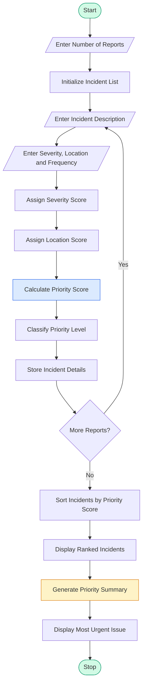

# Smart Campus Incident and Maintenance Prioritization System

## 1. Problem Statement
 Smart Campus Incident and Maintenance Prioritization: Classify hypothetical maintenance reports using severity, location, and reported frequency; rank cases using predefined rules and generate a priority summary. 


## 2. Algorithm

1. Start the program.
2. Get the number of maintenance reports.
3. For each report, input:
   - Incident description.
   - Severity level.
   - Location.
   - Number of times reported.
4. Assign severity scores:
   - Low = 1
   - Medium = 2
   - High = 3
   - Critical = 4
5. Assign location importance scores:
   - Classroom = 2
   - Library = 2
   - Laboratory = 3
   - Hostel = 3
   - Electrical Room = 4
   - Other = 1
6. Calculate the priority score using:

$$
Priority = (Severity \times 5) + (Location \times 3) + (Frequency \times 2)
$$

7. Classify priority:
   - Score ≥ 35: Critical Priority
   - Score ≥ 25: High Priority
   - Score ≥ 15: Medium Priority
   - Otherwise: Low Priority
8. Sort all incidents in descending order of priority score.
9. Display the ranked incident list.
10. Generate a priority summary.
11. Stop.

## 3. Flowchart

A Technical Look at the Hackviser Platform and the SambaCry (CVE-2017–7494) Lab Walkthrough | by Çağrı Ceyhan | Medium

[medium.com](<https://medium.com/%40cagriceyhan20/a-technical-look-at-the-hackviser-platform-and-the-sambacry-cve-2017-7494-lab-walkthrough-1d737dcdbc2c?utm_source=chatgpt.com>)

## 4. Python Source Code

python

```python

# Smart Campus Incident and Maintenance Prioritization System

# Severity scores
severity_scores = {
    "low": 1,
    "medium": 2,
    "high": 3,
    "critical": 4
}

# Location importance scores
location_scores = {
    "classroom": 2,
    "library": 2,
    "laboratory": 3,
    "hostel": 3,
    "electrical room": 4,
    "other": 1
}

# Function to calculate priority
def calculate_priority(severity, location, frequency):
    score = (
        severity_scores[severity] * 5 +
        location_scores.get(location, 1) * 3 +
        frequency * 2
    )
    return score

# Function to classify priority
def classify_priority(score):
    if score >= 35:
        return "Critical"
    elif score >= 25:
        return "High"
    elif score >= 15:
        return "Medium"
    else:
        return "Low"


# Main program
incidents = []

n = int(input("Enter number of maintenance reports: "))

for i in range(n):
    print("\nEnter details for Incident", i + 1)

    description = input("Incident description: ")
    severity = input(
        "Severity (Low/Medium/High/Critical): "
    ).strip().lower()

    location = input(
        "Location (Classroom/Library/Laboratory/"
        "Hostel/Electrical Room/Other): "
    ).strip().lower()

    frequency = int(
        input("Number of times reported: ")
    )

    if severity not in severity_scores:
        print("Invalid severity! Using Medium.")
        severity = "medium"

    if frequency < 0:
        print("Invalid frequency! Using 0.")
        frequency = 0

    score = calculate_priority(
        severity, location, frequency
    )

    priority = classify_priority(score)

    incidents.append({
        "description": description,
        "severity": severity,
        "location": location,
        "frequency": frequency,
        "score": score,
        "priority": priority
    })


# Sort incidents by priority score
incidents.sort(
    key=lambda x: x["score"],
    reverse=True
)

# Display ranked incidents
print("\n========== INCIDENT PRIORITY RANKING ==========")

for rank, incident in enumerate(incidents, start=1):
    print(f"\nRank: {rank}")
    print("Description:", incident["description"])
    print("Severity:", incident["severity"].title())
    print("Location:", incident["location"].title())
    print("Frequency:", incident["frequency"])
    print("Priority Score:", incident["score"])
    print("Priority Level:", incident["priority"])


# Generate priority summary
summary = {
    "Critical": 0,
    "High": 0,
    "Medium": 0,
    "Low": 0
}

for incident in incidents:
    summary[incident["priority"]] += 1

print("\n========== PRIORITY SUMMARY ==========")
print("Total Incidents:", len(incidents))

for level, count in summary.items():
    print(level, "Priority:", count)

if incidents:
    print("\nMost Urgent Issue:",
          incidents[0]["description"])
    print("Recommended Action:",
          "Attend to the highest-ranked incident first.")

print("\nMaintenance prioritization completed.")
```

## 5. Sample Input

text

```text
Enter number of maintenance reports: 4

Enter details for Incident 1
Incident description: Electrical short circuit
Severity: Critical
Location: Electrical Room
Number of times reported: 5

Enter details for Incident 2
Incident description: Projector not working
Severity: Medium
Location: Classroom
Number of times reported: 3

Enter details for Incident 3
Incident description: Water leakage
Severity: High
Location: Hostel
Number of times reported: 4

Enter details for Incident 4
Incident description: WiFi not working
Severity: Low
Location: Library
Number of times reported: 2
```

## 6. Sample Output

text

```text
========== INCIDENT PRIORITY RANKING ==========

Rank: 1
Description: Electrical short circuit
Severity: Critical
Location: Electrical Room
Frequency: 5
Priority Score: 45
Priority Level: Critical

Rank: 2
Description: Water leakage
Severity: High
Location: Hostel
Frequency: 4
Priority Score: 35
Priority Level: Critical

Rank: 3
Description: Projector not working
Severity: Medium
Location: Classroom
Frequency: 3
Priority Score: 22
Priority Level: Medium

Rank: 4
Description: WiFi not working
Severity: Low
Location: Library
Frequency: 2
Priority Score: 15
Priority Level: Medium

========== PRIORITY SUMMARY ==========

Total Incidents: 4
Critical Priority: 2
High Priority: 0
Medium Priority: 2
Low Priority: 0

Most Urgent Issue: Electrical short circuit

Recommended Action:
Attend to the highest-ranked incident first.

Maintenance prioritization completed.
```

## 7. Mermaid Flowchart Code

You can copy this code into [Mermaid Live Editor](<https://mermaid.live/?utm_source=chatgpt.com>) to generate the flowchart.

mermaid



## 8. Expected Result

The Smart Campus Incident and Maintenance Prioritization System successfully:

1. Collects maintenance reports from users.
2. Classifies incidents based on severity and location.
3. Considers the frequency of reported problems.
4. Calculates priority scores automatically.
5. Ranks incidents from highest to lowest priority.
6. Generates a summary of critical, high, medium, and low-priority incidents.

## 9. Conclusion

The Smart Campus Incident and Maintenance Prioritization System helps campus administrators manage maintenance problems efficiently. By using severity, location, and frequency-based scoring, the system identifies urgent issues and ensures that important problems receive attention first. It reduces manual effort, improves maintenance planning, and contributes to a safer and smarter campus environment.

Note: The scoring weights and thresholds are predefined example rules and can be adjusted according to campus requirements. In a real campus, electrical short circuits and similar safety hazards should also trigger immediate emergency procedures regardless of their calculated score.
