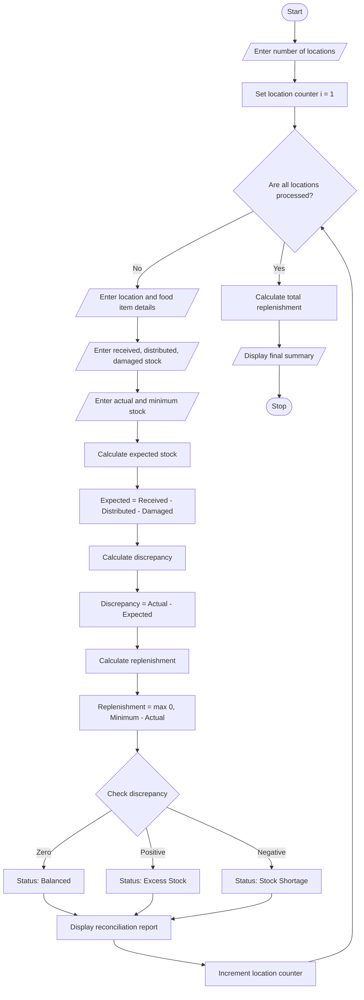

# Food Supply Chain Stock Reconciliation System Using Python

## 1. Problem Statement
3. Food Supply Chain Stock Reconciliation: Compare quantities received, distributed, damaged, and remaining across several locations; identify discrepancies and calculate replenishment requirements. 

## 2. Algorithm

1. Start the program.
2. Enter the number of locations.
3. For each location, enter:
   - Location name.
   - Food item name.
   - Quantity received.
   - Quantity distributed.
   - Quantity damaged.
   - Actual remaining stock.
   - Minimum required stock.
4. Calculate expected remaining stock using:

$$
Expected = Received - Distributed - Damaged
$$

5. Calculate stock discrepancy:

$$
Discrepancy = Actual - Expected
$$

6. Calculate replenishment requirement:

$$
Replenishment = \max(0, Minimum - Actual)
$$

7. Display the expected stock, actual stock, discrepancy, and replenishment quantity.
8. Identify whether stock is balanced, excess, or short.
9. Repeat for all locations.
10. Stop the program.

## 3. Flowchart

How to reconcile inventory: step-by-step process, formulas, and tools

[cleverence.com](<https://www.cleverence.com/articles/for-business/how-to-reconcile-inventory-7394/?utm_source=chatgpt.com>)

## 4. Python Source Code

python

```python

# Food Supply Chain Stock Reconciliation System

locations = []

n = int(input("Enter number of locations: "))

for i in range(n):
    print("\nLocation", i + 1)

    name = input("Enter location name: ")
    item = input("Enter food item name: ")

    received = int(input("Quantity received: "))
    distributed = int(input("Quantity distributed: "))
    damaged = int(input("Quantity damaged: "))
    actual = int(input("Actual remaining stock: "))
    minimum = int(input("Minimum required stock: "))

    # Calculate expected stock
    expected = received - distributed - damaged

    # Calculate discrepancy
    discrepancy = actual - expected

    # Calculate replenishment
    replenishment = max(0, minimum - actual)

    # Determine stock status
    if discrepancy == 0:
        status = "Balanced"
    elif discrepancy > 0:
        status = "Excess Stock"
    else:
        status = "Stock Shortage"

    # Store location details
    locations.append({
        "name": name,
        "item": item,
        "received": received,
        "distributed": distributed,
        "damaged": damaged,
        "expected": expected,
        "actual": actual,
        "discrepancy": discrepancy,
        "replenishment": replenishment,
        "status": status
    })

# Display reconciliation report
print("\n========== STOCK RECONCILIATION REPORT ==========")

for loc in locations:
    print("\nLocation:", loc["name"])
    print("Food Item:", loc["item"])
    print("Received:", loc["received"])
    print("Distributed:", loc["distributed"])
    print("Damaged:", loc["damaged"])
    print("Expected Stock:", loc["expected"])
    print("Actual Stock:", loc["actual"])
    print("Discrepancy:", loc["discrepancy"])
    print("Stock Status:", loc["status"])
    print("Replenishment Required:", loc["replenishment"])

# Calculate total replenishment
total_replenishment = sum(
    loc["replenishment"] for loc in locations
)

print("\n========== SUMMARY ==========")
print("Total Locations:", n)
print("Total Replenishment Required:",
      total_replenishment)

print("\nStock reconciliation completed.")
```

## 5. Sample Input

text

```text
Enter number of locations: 3

Location 1
Enter location name: Vijayawada
Enter food item name: Rice
Quantity received: 500
Quantity distributed: 300
Quantity damaged: 20
Actual remaining stock: 180
Minimum required stock: 200

Location 2
Enter location name: Guntur
Enter food item name: Wheat
Quantity received: 400
Quantity distributed: 200
Quantity damaged: 10
Actual remaining stock: 190
Minimum required stock: 150

Location 3
Enter location name: Hyderabad
Enter food item name: Rice
Quantity received: 600
Quantity distributed: 350
Quantity damaged: 30
Actual remaining stock: 210
Minimum required stock: 250
```

## 6. Sample Output

text

```text
========== STOCK RECONCILIATION REPORT ==========

Location: Vijayawada
Food Item: Rice
Received: 500
Distributed: 300
Damaged: 20
Expected Stock: 180
Actual Stock: 180
Discrepancy: 0
Stock Status: Balanced
Replenishment Required: 20

Location: Guntur
Food Item: Wheat
Received: 400
Distributed: 200
Damaged: 10
Expected Stock: 190
Actual Stock: 190
Discrepancy: 0
Stock Status: Balanced
Replenishment Required: 0

Location: Hyderabad
Food Item: Rice
Received: 600
Distributed: 350
Damaged: 30
Expected Stock: 220
Actual Stock: 210
Discrepancy: -10
Stock Status: Stock Shortage
Replenishment Required: 40

========== SUMMARY ==========

Total Locations: 3
Total Replenishment Required: 60

Stock reconciliation completed.
```

## 7. Mermaid Flowchart Code

You can copy this code into the [Mermaid Live Editor](<https://mermaid.live/?utm_source=chatgpt.com>) to generate the flowchart.

mermaid



## 8. Expected Result

The Food Supply Chain Stock Reconciliation System successfully:

- Tracks food stock received, distributed, and damaged across multiple locations.
- Calculates expected and actual remaining stock.
- Identifies stock discrepancies.
- Detects excess stock and stock shortages.
- Calculates replenishment requirements for each location.
- Generates a consolidated stock reconciliation report.

Conclusion: This Python-based system helps improve food inventory accuracy, reduce wastage, identify stock differences, and ensure timely replenishment across multiple food supply chain locations.
