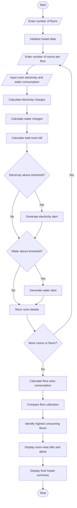

# 2. Smart Hostel Resource Monitoring System Using Python

## 1. Problem Statement
Smart Hostel Resource Monitoring: Analyse room-wise electricity and water consumption, calculate charges, identify threshold violations, and compare resource utilization across floors


## 2. Algorithm

1. Start the program.
2. Enter the number of floors in the hostel.
3. Enter the number of rooms on each floor.
4. Input electricity consumption (kWh) and water consumption (litres) for each room.
5. Define electricity and water charges per unit.
6. Calculate electricity charges for each room.
7. Calculate water charges for each room.
8. Calculate the total bill for each room.
9. Compare consumption with the predefined thresholds.
10. Display warnings for rooms exceeding the thresholds.
11. Calculate total electricity and water consumption floor-wise.
12. Compare resource utilization across all floors.
13. Display room-wise bills, threshold violations, and floor-wise consumption reports.
14. Stop the program.

## 3. Flowchart

PPT - Pseudocode PowerPoint Presentation, free download - ID:3801861

[slideserve.com](<https://www.slideserve.com/hinto/pseudocode?utm_source=chatgpt.com>)

## 4. Python Source Code

python

```python

# Smart Hostel Resource Monitoring System

# Utility rates
ELECTRICITY_RATE = 8       # Rs per kWh
WATER_RATE = 0.05          # Rs per litre

# Consumption thresholds
ELECTRICITY_LIMIT = 100    # kWh
WATER_LIMIT = 1000         # Litres

# Hostel details
hostel = {}

floors = int(input("Enter number of floors: "))

# Input room-wise consumption
for floor in range(1, floors + 1):

    rooms = int(input(f"\nEnter number of rooms on Floor {floor}: "))

    hostel[floor] = []

    for room in range(1, rooms + 1):

        print(f"\nFloor {floor} - Room {room}")

        electricity = float(
            input("Enter electricity consumption (kWh): ")
        )

        water = float(
            input("Enter water consumption (litres): ")
        )

        # Calculate charges
        electricity_bill = electricity * ELECTRICITY_RATE
        water_bill = water * WATER_RATE

        total_bill = electricity_bill + water_bill

        # Check threshold violations
        violations = []

        if electricity > ELECTRICITY_LIMIT:
            violations.append("High Electricity")

        if water > WATER_LIMIT:
            violations.append("High Water")

        hostel[floor].append({
            "room": room,
            "electricity": electricity,
            "water": water,
            "electricity_bill": electricity_bill,
            "water_bill": water_bill,
            "total_bill": total_bill,
            "violations": violations
        })

# Display room-wise report
print("\n========== ROOM-WISE REPORT ==========")

for floor, rooms in hostel.items():

    print(f"\nFloor {floor}")

    for data in rooms:

        print(f"\nRoom {data['room']}")
        print("Electricity:", data["electricity"], "kWh")
        print("Water:", data["water"], "Litres")
        print("Electricity Bill: Rs.", data["electricity_bill"])
        print("Water Bill: Rs.", data["water_bill"])
        print("Total Bill: Rs.", data["total_bill"])

        if data["violations"]:
            print("ALERT:", ", ".join(data["violations"]))
        else:
            print("Status: Normal")

# Floor-wise comparison
print("\n========== FLOOR-WISE ANALYSIS ==========")

floor_totals = {}

for floor, rooms in hostel.items():

    total_electricity = sum(
        room["electricity"] for room in rooms
    )

    total_water = sum(
        room["water"] for room in rooms
    )

    total_amount = sum(
        room["total_bill"] for room in rooms
    )

    floor_totals[floor] = {
        "electricity": total_electricity,
        "water": total_water,
        "amount": total_amount
    }

    print(f"\nFloor {floor}")
    print("Total Electricity:", total_electricity, "kWh")
    print("Total Water:", total_water, "Litres")
    print("Total Charges: Rs.", total_amount)

# Identify highest consuming floor
highest_electricity = max(
    floor_totals,
    key=lambda x: floor_totals[x]["electricity"]
)

highest_water = max(
    floor_totals,
    key=lambda x: floor_totals[x]["water"]
)

print("\n========== FINAL SUMMARY ==========")

print("Highest Electricity Consumption: Floor",
      highest_electricity)

print("Highest Water Consumption: Floor",
      highest_water)

grand_total = sum(
    data["amount"] for data in floor_totals.values()
)

print("Total Hostel Bill: Rs.", grand_total)

print("\nMonitoring Completed Successfully!")
```

## 5. Sample Input

text

```text
Enter number of floors: 2

Enter number of rooms on Floor 1: 2

Floor 1 - Room 1
Enter electricity consumption (kWh): 80
Enter water consumption (litres): 700

Floor 1 - Room 2
Enter electricity consumption (kWh): 120
Enter water consumption (litres): 1200

Enter number of rooms on Floor 2: 2

Floor 2 - Room 1
Enter electricity consumption (kWh): 90
Enter water consumption (litres): 800

Floor 2 - Room 2
Enter electricity consumption (kWh): 150
Enter water consumption (litres): 900
```

## 6. Sample Output

text

```text
========== ROOM-WISE REPORT ==========

Floor 1

Room 1
Electricity: 80.0 kWh
Water: 700.0 Litres
Electricity Bill: Rs. 640.0
Water Bill: Rs. 35.0
Total Bill: Rs. 675.0
Status: Normal

Room 2
Electricity: 120.0 kWh
Water: 1200.0 Litres
Electricity Bill: Rs. 960.0
Water Bill: Rs. 60.0
Total Bill: Rs. 1020.0
ALERT: High Electricity, High Water

Floor 2

Room 1
Electricity: 90.0 kWh
Water: 800.0 Litres
Electricity Bill: Rs. 720.0
Water Bill: Rs. 40.0
Total Bill: Rs. 760.0
Status: Normal

Room 2
Electricity: 150.0 kWh
Water: 900.0 Litres
Electricity Bill: Rs. 1200.0
Water Bill: Rs. 45.0
Total Bill: Rs. 1245.0
ALERT: High Electricity

========== FLOOR-WISE ANALYSIS ==========

Floor 1
Total Electricity: 200.0 kWh
Total Water: 1900.0 Litres
Total Charges: Rs. 1695.0

Floor 2
Total Electricity: 240.0 kWh
Total Water: 1700.0 Litres
Total Charges: Rs. 2005.0

========== FINAL SUMMARY ==========

Highest Electricity Consumption: Floor 2
Highest Water Consumption: Floor 1
Total Hostel Bill: Rs. 3700.0

Monitoring Completed Successfully!
```

## 7. Mermaid Flowchart Code

You can copy this code into the [Mermaid Live Editor](<https://mermaid.live/?utm_source=chatgpt.com>) to generate the flowchart.

mermaid



## 8. Expected Result

The Smart Hostel Resource Monitoring System successfully:

- Calculates electricity and water charges for every room.
- Identifies rooms exceeding electricity and water consumption limits.
- Generates alerts for excessive resource consumption.
- Compares electricity and water utilization across different floors.
- Identifies the floor with the highest resource consumption.
- Calculates the total hostel utility bill.

Conclusion: This project helps hostel administrators monitor utility usage, identify resource wastage, control expenses, and promote efficient electricity and water consumption.
