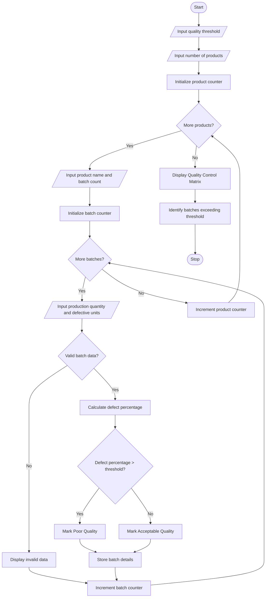

# 60. Manufacturing Quality Control Matrix Using Python

## 1. Problem Statement
 Manufacturing Quality Control Matrix: Analyse production quantities and defective units across products and batches, calculate defect percentages, and identify batches exceeding quality thresholds


## 2. Algorithm

1. Start the program.
2. Input the number of products.
3. Input the product name and number of batches.
4. Set the acceptable defect percentage (quality threshold).
5. For each batch:
   - Input total production quantity.
   - Input the number of defective units.
   - Calculate defect percentage using:

$$
\text{Defect Percentage} =
\frac{\text{Defective Units}}{\text{Production Quantity}}\times 100
$$

6. Compare the defect percentage with the quality threshold.
7. If the defect percentage is greater than the threshold, mark the batch as Poor Quality.
8. Otherwise, mark the batch as Acceptable Quality.
9. Display the product name, batch number, production quantity, defective units, defect percentage and quality status.
10. Stop.

## 3. Flowchart

不良率【定義・PPM・歩留まり・許容範囲・原因と改善策】

[smartmat.io](<https://www.smartmat.io/column/production_management/8208?utm_source=chatgpt.com>)

## 4. Python Source Code

python

```python

# Manufacturing Quality Control Matrix

# Input quality threshold
threshold = float(input("Enter acceptable defect threshold (%): "))

# Input number of products
n = int(input("Enter number of products: "))

# Store batch details
quality_matrix = []

for i in range(n):
    product = input("\nEnter product name: ")
    batches = int(input("Enter number of batches: "))

    for j in range(batches):
        print("\nProduct:", product)
        print("Batch:", j + 1)

        production = int(input("Enter production quantity: "))
        defective = int(input("Enter defective units: "))

        # Validate quantities
        if production <= 0 or defective < 0 or defective > production:
            print("Invalid batch data!")
            continue

        # Calculate defect percentage
        defect_percentage = (defective / production) * 100

        # Check quality threshold
        if defect_percentage > threshold:
            status = "Poor Quality"
        else:
            status = "Acceptable Quality"

        # Store results
        quality_matrix.append([
            product,
            j + 1,
            production,
            defective,
            defect_percentage,
            status
        ])

# Display quality control matrix
print("\n========== QUALITY CONTROL MATRIX ==========")

print("{:<12} {:<8} {:<12} {:<12} {:<12} {}".format(
    "Product", "Batch", "Production",
    "Defective", "Defect %", "Status"
))

for record in quality_matrix:
    print("{:<12} {:<8} {:<12} {:<12} {:<12.2f} {}".format(
        record[0], record[1], record[2],
        record[3], record[4], record[5]
    ))

# Identify batches exceeding threshold
print("\nBatches Exceeding Quality Threshold:")

found = False

for record in quality_matrix:
    if record[4] > threshold:
        print("Product:", record[0],
              "| Batch:", record[1],
              "| Defect:", round(record[4], 2), "%")
        found = True

if not found:
    print("No batches exceed the quality threshold.")

print("\nQuality analysis completed.")
```

## 5. Sample Input

text

```text
Enter acceptable defect threshold (%): 5

Enter number of products: 2

Enter product name: Mobile
Enter number of batches: 2

Product: Mobile
Batch: 1
Enter production quantity: 1000
Enter defective units: 30

Product: Mobile
Batch: 2
Enter production quantity: 800
Enter defective units: 60

Enter product name: Laptop
Enter number of batches: 2

Product: Laptop
Batch: 1
Enter production quantity: 500
Enter defective units: 10

Product: Laptop
Batch: 2
Enter production quantity: 600
Enter defective units: 45
```

## 6. Sample Output

text

```text
========== QUALITY CONTROL MATRIX ==========

Product      Batch    Production   Defective    Defect %    Status

Mobile       1        1000         30           3.00        Acceptable Quality
Mobile       2        800          60           7.50        Poor Quality
Laptop       1        500          10           2.00        Acceptable Quality
Laptop       2        600          45           7.50        Poor Quality

Batches Exceeding Quality Threshold:

Product: Mobile | Batch: 2 | Defect: 7.5 %
Product: Laptop | Batch: 2 | Defect: 7.5 %

Quality analysis completed.
```

## 7. Mermaid Flowchart Code

You can copy this code into the Mermaid Live Editor to generate the flowchart.

mermaid



## 8. Result

The Manufacturing Quality Control Matrix program was successfully implemented using Python.

It calculates the defect percentage for each product batch, compares it with the given quality threshold, and identifies batches that exceed the acceptable defect limit. This helps manufacturing industries monitor product quality and identify batches requiring corrective action.
